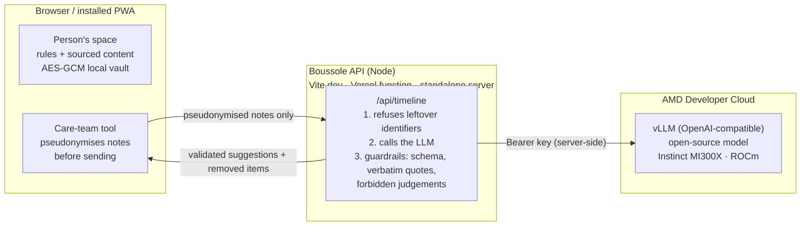

# Boussole

**We walk with you, step by step.** Boussole ("compass" in French) guides a person after a sexual assault in Montréal: where to go, how to tell their story only once, and, if they decide to, how to build a file for a legal service. A second screen helps the care team at a designated centre structure the night's notes. **The AI guides, the human decides.**

AMD Developer Hackathon: ACT III (lablab.ai) · Track: **Health and Wellbeing** · Fictional data only, not a medical device.

| | |
|---|---|
| App (PWA, French UI) | `app/` · run it locally in under 5 minutes (below). Public URL: **to be added at submission** |
| AI on AMD | Open-source LLM served by **vLLM on AMD Instinct MI300X (ROCm), AMD Developer Cloud** → [`GUIDE_AMD.md`](GUIDE_AMD.md) |
| Safety | [`SAFETY.md`](SAFETY.md): wrong or unsupported answers, sensitive data, uncertainty, risky decisions |
| Submission kit | [`submission/`](submission/) |

---

## The problem

After a sexual assault, the first hours decide a lot, and the path is confusing:

- **Where to go?** In 2020, a woman went to three Montréal hospitals before getting a forensic kit ([Noovo](https://www.noovo.info/nouvelle/pourquoi-une-femme-francophone-sest-vu-refuser-une-trousse-medicolegale.html)).
- **Evidence expires.** Most drugs are no longer detectable in blood after about 24 hours, in urine after about 120 hours ([SOFT DFSA fact sheet](https://www.soft-tox.org/assets/docs/DFSA_Fact_Sheet.pdf)).
- **Few cases move forward.** About 6% of sexual assaults are reported to police ([Statistics Canada, 2019 victimization](https://www150.statcan.gc.ca/pub/85-002-x/2021001/article/00014-fra.htm)); of 1,000 police-reported sexual assault incidents, 640 end without a charge ([Statistics Canada, 2015–2019](https://www150.statcan.gc.ca/n1/pub/11-627-m/11-627-m2024051-fra.htm)).
- **People retell their story again and again**, to different professionals, while care teams rebuild a timeline from scattered notes.

## The solution

**For the person (`#/`)**, no AI involved:

1. Five calm intro slides, then a local account: the story is **encrypted on the device** (AES-256-GCM, key from the password). No server receives it.
2. **The care steps, in order**, from official Québec and Montréal sources: safety (911), Info-aide violence sexuelle, preserving evidence, designated centres, care time windows, the forensic-kit choice, support, rights.
3. **My story**, once, at their own pace ("I don't know" is a valid answer).
4. **Where to go**: map of verified Montréal resources; anything not confirmed by an official source is badged **"À confirmer"**.
5. **My file**: they choose the sections, give explicit consent and confirm twice before a (simulated) transmission to Rebâtir, the free legal-advice service for survivors.

**For the care team (`#/demo`)**: per-item consent, guided intake, a **deterministic rule engine** for sample time windows (no AI), an **AI-assisted timeline** in which every line quotes its source and waits for human validation, and a SHA-256 hash-chained custody log.

**Installable PWA**, mobile first, works offline (the encrypted space opens without network; the offline page shows emergency numbers).

## Architecture



| Path | Role |
|---|---|
| `app/src/` | React 19 + Vite + Tailwind app (person's space, care-team tool, PWA) |
| `app/src/lib/rules.ts` | Rule engine (time windows), labelled *not clinically validated* |
| `app/src/lib/pseudonymize.ts`, `app/shared/identifiers.js` | Client pseudonymisation and the server's second check |
| `app/server/llm.js` | OpenAI-compatible provider (fetch only), configured by `VLLM_BASE_URL`, `VLLM_MODEL`, `VLLM_API_KEY` |
| `app/server/timeline.js` | Prompt, JSON schema and guardrails |
| `app/server/handler.js` | `/api/timeline` and `/api/health`, mounted by Vite, `app/api/` (serverless) and `app/server/standalone.js` |
| `app/scripts/mock-vllm.js`, `app/scripts/bench.js` | Fake OpenAI-compatible server for tests, benchmark |
| `pitch/`, `video/`, `spot-v1/`, `spot-v2/` | Earlier pitch, Remotion demo video and ad spots (French) |

## How AMD is used

The AI part of the product, the care-team **timeline**, runs on an **open-source model served by vLLM on an AMD Instinct MI300X GPU (ROCm) on AMD Developer Cloud**. It is the live feature shown in the demo.

- The app talks to any **OpenAI-compatible** endpoint; we use vLLM's, started with `--api-key`.
- Generation is constrained by a **JSON schema** (`response_format`), temperature 0.
- The key never reaches the browser. The server sends **pseudonymised notes only** and refuses anything that still contains a direct identifier.
- If the endpoint is down, slow or misconfigured, the app shows a **clearly labelled pre-recorded answer** and says why.
- Default model: `Qwen/Qwen2.5-7B-Instruct` (Apache 2.0, no Hugging Face token needed). The single 192 GB MI300X leaves room to try larger models and compare with the benchmark.

Step-by-step setup (account, GPU droplet, vLLM, key, test, deployment options): [`GUIDE_AMD.md`](GUIDE_AMD.md).

## Benchmark

`cd app && npm run bench` sends 3 fictional notes several times at concurrency 1 and 4 and records latency, tokens/s and how many lines the guardrails kept or removed.

**AMD Instinct MI300X (vLLM, ROCm)**: _results to be pasted here from `app/bench/results.md` after running the benchmark on the AMD endpoint (date, model, vLLM version)._

Harness check against the **local mock server** (no model, no GPU: these numbers say nothing about AMD hardware):

| Concurrency | OK requests | Latency p50 | Latency p95 | Tokens/s per request | Total throughput (tokens/s) | Requests/min | Guardrails (events) |
|---|---|---|---|---|---|---|---|
| 1 | 6/6 | 1.16 s | 1.66 s | 387 | 388 | 51.1 | 60 kept / 0 removed |
| 4 | 6/6 | 1.16 s | 1.66 s | 387 | 972 | 128.0 | 60 kept / 0 removed |

## Safety in one table

Full details: [`SAFETY.md`](SAFETY.md).

| Concern | What Boussole does |
|---|---|
| Wrong or unsupported AI output | Schema check; every line must quote the notes **verbatim**, or it is removed; culprit, credibility, score, diagnosis and legal-qualification wording is removed; removed items are shown; a human validates every line |
| Sensitive information | Pseudonymisation in the browser, second check on the server (HTTP 422, nothing sent), key server-side, no note content in logs, API never cached, the person's story encrypted on the device only |
| Uncertain results | Live vs. pre-recorded label with the reason; "don't know" kept as its own answer and flagged "to confirm"; rules labelled *not clinically validated*; unconfirmed resources badged "À confirmer" |
| Risky decisions | Per-item consent; police transmission off by default and only by the person; double confirmation before sending a file; 911 and Info-aide one tap away |

## Limits

- Prototype on **fictional data**. Rules not clinically validated; not tested with survivors or care teams yet.
- Pattern-based pseudonymisation is not named-entity recognition; the citation check proves a quote exists, not that the summary is faithful (hence human validation).
- The model has not been evaluated on real clinical notes; the benchmark measures speed, not clinical quality.
- Sending a file to Rebâtir is **simulated**. The person's account lives on one device (a forgotten password makes the story unreadable).
- The UI is in French (Montréal, Québec); this README and the safety docs are in English for the jury.

## Run it in under 5 minutes

Requirements: Node.js 22.9 or newer.

```bash
git clone https://github.com/sam-halimi/hackathon-AMDchallenge-Samsam.git
cd hackathon-AMDchallenge-Samsam/app
npm ci
npm run dev            # http://localhost:5173  (person's space)  ·  /#/demo  (care-team tool)
```

Without an AI endpoint the timeline uses the labelled pre-recorded answer. To see the live path without a GPU:

```bash
npm run mock           # terminal 1: fake OpenAI-compatible server on :8001 (no AI)
cp .env.example .env   # then set VLLM_BASE_URL=http://127.0.0.1:8001/v1 and VLLM_MODEL=mock-model
npm run dev            # terminal 2
```

With the AMD endpoint: fill `.env` as in [`GUIDE_AMD.md`](GUIDE_AMD.md) §6.

Other commands (in `app/`): `npm test` (49 tests: pseudonymisation, rules, resources, guardrails, API), `npm run lint`, `npm run build`, `npm start` (standalone server: built app + API on :8080), `npm run bench`.

## Business value

- **Who pays**: health institutions (CISSS/CIUSSS) that host designated centres; Québec counted 77 designated centres in 17 regions in a 2011 study (to be re-checked with the ministry). Hypothesis: yearly licence per centre plus setup and training; co-funding possible from victim-support funds.
- **Who uses it**: nurses, physicians and social workers at designated centres; survivors, **always free**.
- **Who receives, never pays**: police and prosecutors, only with the person's consent, a deliberate trust choice.
- **Next step**: a 3-month pilot with one designated centre, measuring repeated retellings, samples taken within time windows and administrative time.

## Repositories and links

- This repository: [sam-halimi/hackathon-AMDchallenge-Samsam](https://github.com/sam-halimi/hackathon-AMDchallenge-Samsam) (everything needed to run and judge the project).
- Origin of the code: [sam-halimi/hackathon-codeML-SAA](https://github.com/sam-halimi/hackathon-codeML-SAA/tree/boussole/boussole), branch `boussole`, folder `boussole/` (earlier version built for another challenge; it also holds the heavy media excluded here, see [`ASSETS.md`](ASSETS.md)).
- Earlier static beta, without live AI: https://boussole-beta.vercel.app
- Research behind every resource and time window: [`app/src/lib/research-resources.md`](app/src/lib/research-resources.md) (French, with URLs).
