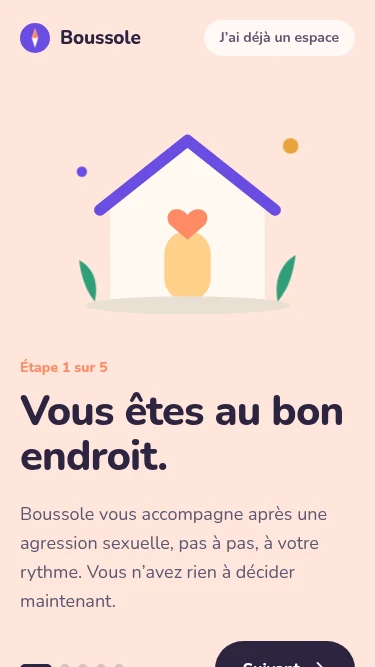
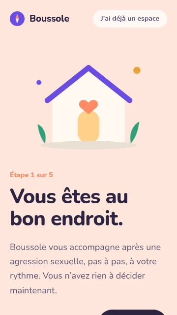
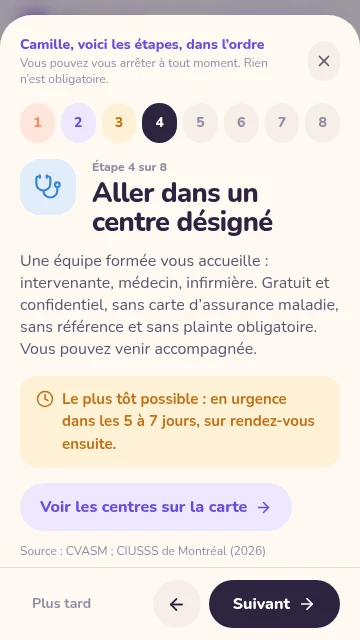
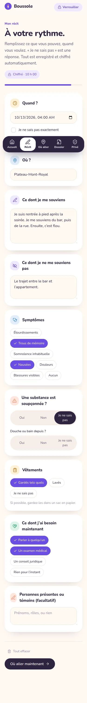

# Audit UX de Boussole (V1, avant refonte)

Branche `ux-v2`, état du code : étiquette `v1-avant-ux` (`a42402a`). Audit du 14 octobre 2026. Rien n'a été modifié dans l'application.

## Méthode

- Application construite (`npm run build`) et servie par `npm start`, pilotée par Chrome sans interface.
- 38 états d'écran capturés dans chacun des trois formats : **375×667**, **360×640** (émulation tactile) et **1280×800**. Soit 114 captures d'écran, plus les pages entières quand elles défilent (`--page`).
- Script : [`capture.mjs`](capture.mjs). Captures : [`avant/`](avant/). Mesures brutes : [`avant/mesures.json`](avant/mesures.json).
- Chaque capture est accompagnée de mesures faites dans la page : rapport de contraste de chaque texte sur son fond réel, taille de chaque zone de clic, taille de chaque texte, défilements internes, débordements, hauteur de page.
- Grilles utilisées : `impeccable` (audit technique en 5 dimensions, détecteur automatique), `taste` (`redesign-existing-projects`, liste de défauts génériques), `emilkowalski` (`emil-design-eng` et `review-animations`, pour le mouvement).
- Référence V1 : `npm run lint` 0 erreur (6 avertissements), `npm test` 49 tests réussis, `npm run build` réussi. Console du navigateur : aucune erreur, hormis le 503 attendu de `/api/timeline` (pas d'IA configurée).

Limites, à lire avant de conclure :

- Tout est mesuré en émulation mobile de Chrome sur un serveur, pas sur un vrai téléphone. Les gestes tactiles (carte, glissements) sont jugés sur le code, pas essayés au doigt.
- Pas de test avec un lecteur d'écran, ni avec la taille de police du système agrandie.
- La critique de design d'`impeccable` demande deux évaluations isolées par sous-agents ; elle a été faite ici en une seule passe. Seule la note de l'audit technique est donnée.
- Fausses alertes écartées : le texte clair des boutons « Oui / Non / Je ne sais pas » sélectionnés (le fond foncé est un élément voisin, que la mesure ne voit pas) ; les boutons désactivés, exemptés par la norme mais signalés quand ils portent la seule explication de l'écran.

## Verdict

La V1 a une vraie personnalité (papier crème, violet, formes rondes, ton juste) et aucun parcours n'est cassé. Mais elle est pensée comme une belle maquette, pas comme un outil pour une personne en état de choc :

1. **Ce qui compte le plus est ce qui se lit le moins.** Le numéro d'Info-aide et « Appeler le 911 » sont en blanc sur corail, contraste 2,31:1 (il faut 4,5). Les mentions de sécurité et les badges « À confirmer » sont en 11 à 12 px, entre 2,6 et 3,7:1.
2. **Le premier écran cache son seul bouton.** Sur téléphone, « Suivant » est coupé par le bas de l'écran (26 px visibles sur 56 en 375×667, une dizaine en 360×640).
3. **Les diapos déforment la page sur mobile.** Chaque « Suivant » élargit la page de 8 px et la laisse zoomée de 2 % de plus, jusqu'à 8,8 % après les cinq diapos.
4. **Trop de choses à la fois.** Mon récit fait 4,4 écrans de formulaire, Où aller 14,7 écrans, Mon dossier place son bouton principal à 2,6 écrans du haut.
5. **Les zones de clic sont trop petites partout.** Aucun bouton secondaire n'atteint 44 px de haut ; les boutons d'appel des fiches font 36 px.

Aucun problème bloquant (P0). 9 problèmes majeurs (P1), 17 mineurs (P2), le reste en finition (P3).

### Note de l'audit technique (grille `impeccable`)

| # | Dimension | Note | Constat principal |
|---|---|---|---|
| 1 | Accessibilité | 2/4 | Contrastes sous la norme AA sur 28 couples de couleurs ; fenêtres sans gestion du focus |
| 2 | Performance | 3/4 | Léger, carte chargée à la demande ; une animation tourne en boucle sans fin |
| 3 | Thème | 3/4 | Jetons de couleur utilisés ; restes de l'ancienne direction artistique codés en dur |
| 4 | Adaptation mobile | 2/4 | Bouton principal sous l'écran, zoom parasite, zones de clic, défilement horizontal interne |
| 5 | Cohérence de l'implémentation | 3/4 | Détecteur automatique : 0 alerte. Deux générations de style cohabitent |
| | **Total** | **13/20** | Acceptable : du travail utile reste à faire |

## Problèmes transverses

### T1 · Contrastes insuffisants, surtout sur l'essentiel (P1)

Seuil AA : 4,5:1 pour le texte courant, 3:1 pour le gros texte (24 px, ou 18,66 px en gras).

| Mesuré | Seuil | Couleurs | Où | Capture |
|---|---|---|---|---|
| 2,31 | 3 | blanc sur corail `#FF8A65`, 24 px | **numéro d'Info-aide** (Accueil, Où aller) | [accueil](avant/375x667/16-accueil.webp) |
| 2,31 | 4,5 | blanc sur corail, 16 px | **« Appeler le 911 »**, « +1 888 933-9007 » dans la fenêtre des étapes | [étape 1](avant/375x667/08-etapes-1.webp) |
| 2,05 | 4,5 | blanc à 85 % sur corail, 14 px | « Info-aide violence sexuelle · gratuit, 24 h/24 » | [accueil](avant/375x667/16-accueil.webp) |
| 2,57 | 4,5 | orange à 80 % sur jaune pâle, 12 px | **« Règles non validées cliniquement… »** | [où aller](avant/375x667/21-ou-aller.webp) |
| 3,73 | 4,5 | blanc sur orange `#C2701A`, 11 px | **badge « À confirmer »** | [fiche](avant/375x667/23-ou-aller-fiche.webp) |
| 3,34 à 3,73 | 4,5 | orange sur jaune pâle ou blanc, 13 à 14 px | délais (« Prophylaxie VIH : dans les 72 h »), « Appelez avant de vous déplacer » | [étape 5](avant/375x667/12-etapes-5.webp) |
| 3,10 à 3,24 | 4,5 | gris `#948BA3` sur crème ou blanc, 12 à 14 px | **adresses, horaires**, sources, « Plus tard », aides de champ, avertissement bêta, textes d'exemple des champs (41 écrans sur 114) | [fiche](avant/375x667/23-ou-aller-fiche.webp) |
| 1,94 à 3,19 | 4,5 | couleur vive sur sa teinte pâle (corail, jaune, vert, bleu), 14 px | « Étape 1 sur 5 », numéros d'étapes | [diapo 1](avant/375x667/01-arrivee-diapo-1.webp) |
| 3,34 | 4,5 | blanc sur vert `#2F9E78`, 14 à 16 px | « Se connecter », préférence cochée du rappel | [connexion](avant/375x667/32-connexion.webp) |
| 3,63 | 4,5 | rouge sur rose pâle, 13 px | bandeau « Données 100 % fictives » de l'outil soignant | [soignant](avant/375x667/33-soignant-1-consentement.webp) |
| 4,19 à 4,38 | 4,5 | rouge `#D64545` sur crème ou blanc | messages d'erreur, « Effacer » | [compte](avant/375x667/07-compte-erreur.webp) |
| 2,58 et 1,97 | (exempté) | boutons désactivés | « Envoyer à Rebâtir », « Choisissez un créneau » : seule indication de ce qui manque, et illisible | [dossier](avant/375x667/24-dossier--page.webp) |

Cause : le violet de marque passe (5,5:1 en blanc sur violet), mais les quatre autres couleurs d'accent et le gris secondaire ont été choisis pour leur douceur, puis utilisés pour du texte.

### T2 · Textes trop petits (P1)

Sur un parcours complet en 375×667, mesuré en nombre de caractères affichés sous 16 px :

| Taille | Caractères | Exemples |
|---|---|---|
| 11 px | 1 158 | badge « À confirmer », empreinte du paquet, numéros des repères de carte |
| 12 px | 5 186 | avertissement bêta, sources, mention des règles non validées, « Format attendu » |
| 13 px | 9 394 | **adresses, horaires, numéros de téléphone des fiches**, titres de rubrique |
| 14 px | 15 108 | boutons secondaires, puces, libellés de champs, notes |
| 15 px | 8 076 | conseils des étapes, délais, descriptions |

Les informations dont dépend un déplacement (adresse, horaires) sont en 13 px gris clair. Capture : [fiche d'une ressource](avant/375x667/23-ou-aller-fiche.webp).

### T3 · Zones de clic trop petites (P1)

Repère : 44 px minimum (48 px recommandé pour ce public). Hors carte, en 375×667 :

| Élément | Taille | Écrans |
|---|---|---|
| Boutons d'appel des fiches (« +1 514 413-8999 ») | 154×36 | Où aller, 19 boutons |
| « Itinéraire Google Maps », « Site » | 185×36, 72×38 | Où aller, 33 boutons |
| Lien d'appel de Rebâtir | 134×**20** | Mon dossier |
| Case « Je ne sais pas exactement » | 287×**31** | Mon récit |
| Puces de réponse (symptômes, besoins, vêtements, préférences) | 38 de haut | Mon récit, Rappel |
| Créneaux horaires | 74×43 | Rappel, 19 à 26 boutons |
| « Verrouiller », logo cliquable | 122×36, 121×37 | tous les onglets |
| « J'ai déjà un espace », « Revoir la présentation » | 36 de haut | arrivée, compte, connexion |
| Numéros d'étapes, croix de fermeture | 37×40, 34×40 | fenêtre des étapes |
| « Plus tard », « Tout effacer », « Revoir les étapes » | 36 de haut | étapes, récit, accueil |
| Points de progression des diapos (cliquables) | 10×10 | arrivée |
| Œil du mot de passe | 36×36 | compte, connexion |
| Outil soignant : cases des prélèvements, « Rejeter », « Retour » | 24×24, 27×26, 66×20 | `#/demo` |

Sur la carte : repères de 34×34, boutons de zoom de 30×30.

### T4 · La page se déforme pendant les diapos (P1)

Mesuré dans [`mesures.json`](avant/mesures.json) (`largeurContenu`, `echelle`) :

| Diapo | Largeur du contenu (écran de 375) | Zoom de la page |
|---|---|---|
| 1 | 375 | 1,000 |
| 2 | 383 | 1,000 |
| 3 | 383 | 1,021 |
| 4 | 383 | 1,043 |
| 5 | 383 | 1,065 |
| écran suivant | 375 | **1,088** |

Cause certaine : l'animation d'arrivée décale le texte de 28 px vers la droite (`slideL`), ce qui le fait sortir de la page (355 + 28 = 383). Effet visible : sur la [diapo 5](avant/375x667/05-arrivee-diapo-5.webp), « J'ai déjà un espace » touche le bord et « Créer mon espace » passe sur deux lignes. Le zoom persiste même après rechargement dans l'émulation. À confirmer sur un vrai téléphone, mais la cause est dans le code et la correction est simple. Même mesure en 360×640 (368, zoom 1,092). Rien de tel en 1280×800.

### T5 · Trop de mouvement pour ce public (P1)

Demande explicite : aucune animation qui stresse. Relevé dans le code, au format de revue d'`emilkowalski` :

| Avant | Après proposé | Pourquoi |
|---|---|---|
| `.float` : points décoratifs des illustrations qui montent et descendent en boucle, 6 s, sans fin (Accueil, diapos) | supprimer | mouvement permanent, non déclenché par la personne, sans fonction |
| `.rise` rejouée à **chaque changement d'onglet** (700 ms, décalages jusqu'à 360 ms, soit plus d'une seconde de contenu qui bouge) | un fondu de 150 à 200 ms, sans déplacement, ou rien | action répétée des dizaines de fois : le mouvement doit disparaître |
| Diapos et étapes : glissement latéral de 28 px en 550 ms | fondu simple de 200 ms | supprime aussi le défaut T4 |
| `transition-colors duration-500` sur les puces, cases, interrupteurs, onglets (41 occurrences à 500 ou 700 ms) | 150 ms | un retour d'appui doit être immédiat ; à 500 ms l'interface paraît hésiter |
| Survol : illustrations qui grossissent (`group-hover:scale-105`), flèches qui glissent | supprimer ou réserver à la souris | se déclenche au toucher sur téléphone et reste collé |
| `animate-pulse` sur l'icône de la phase d'envoi en cours | état fixe, coche à la fin | une pulsation évoque l'alerte |
| `html { scroll-behavior: smooth }` et remontée animée à chaque onglet | remontée immédiate | la page défile toute seule pendant que le contenu apparaît |
| Carte : `flyToBounds` de 0,8 s à chaque filtre | cadrage direct | zoom et dézoom non demandés |
| Aiguille du logo qui oscille à l'arrivée (900 ms) | garder, une seule fois | rare, lié à la marque, acceptable |
| `prefers-reduced-motion` : tout coupé d'un bloc | garder | fonctionne ; le réglage par défaut doit déjà être calme |

### T6 · L'aide n'est pas à portée de main partout (P1)

- Pendant les cinq diapos et la création du compte, **aucun numéro d'aide n'est affiché**. Une personne en danger doit passer six écrans avant de voir Info-aide ou le 911.
- Dans Mon récit, Mon dossier et Vie privée, la ligne d'écoute n'est pas accessible sans revenir à l'Accueil.
- Il n'existe aucun moyen de quitter l'application d'un geste. « Verrouiller » ferme l'espace mais laisse Boussole à l'écran.

### T7 · Deux générations de style cohabitent (P2)

Le commentaire en tête de `index.css` décrit deux directions artistiques contradictoires (« Tech institutionnelle, filets 1 px, un seul accent » puis « réconfort, tout est arrondi »). Les écrans portent les deux :

- graisses : titres en 800 sur l'Accueil et les étapes, en 500 dans Mon dossier, les fiches et Vie privée ;
- boutons : pilule pleine partout, sauf « Envoyer à Rebâtir » (`rounded-2xl`) et les boutons à filet 1 px de Mon dossier et de Mon récit ;
- icônes : épaisseur de trait 1,75, 2 ou 2,25 selon l'écran ;
- bouton principal : encre foncée (diapos, étapes, récit), violet (compte, rappel), vert (connexion) ;
- restes codés en dur : ombres `rgba(22,24,29)` et `#F7F5F0` de l'ancienne palette dans les styles de la carte, curseur vert `#0F7A64` dans l'outil soignant.

### T8 · La couleur ne veut rien dire (P2)

- Dans Mon récit, les neuf cartes ont une icône colorée au hasard (jaune, bleu, violet, corail, vert). Le corail, couleur de la ligne d'urgence, sert aussi à décorer « Une substance est soupçonnée ? » (avec un triangle d'alerte) et « Personnes présentes ».
- Dans Où aller, **la carte et la liste ne parlent pas le même code** : examens en bleu sur la carte et en bleu nuit dans la liste, soutien en vert puis en violet, juridique en jaune puis en orange brun. La légende sous la carte ne décrit donc pas la liste. Sur mobile, le nom de la catégorie est masqué dans la fiche : il ne reste que cette pastille. Capture : [carte et première fiche](avant/375x667/22-ou-aller-carte.webp).

### T9 · La barre d'onglets mobile pèse plus que le contenu (P2)

Pastille flottante bleu nuit, ombrée, posée par-dessus la page : c'est l'objet le plus contrasté de chaque écran, et le contenu défile dessous. Libellés en 12 px. « Vie privée » y devient « Privé ». Capture : [accueil](avant/375x667/16-accueil.webp).

### T10 · Le mot « étape » compte quatre choses différentes (P2)

« Étape 1 sur 5 » (diapos), « Dernière étape » (création du compte), « Étape 1 sur 8 » (prise en charge), « Dernière étape » (rappel). Après la « dernière étape », la personne en découvre huit.

### T11 · Fenêtres sans gestion du clavier ni du lecteur d'écran (P2)

- Fenêtre des étapes : le focus y entre, mais n'y est pas retenu.
- Confirmation d'envoi : ni focus déplacé, ni fermeture par Échap.
- Créneaux du rappel déclarés `listbox` sans navigation au clavier ; points des diapos déclarés `tablist` sans onglets.
- Cartes de ressource cliquables (`<li onClick>`) inaccessibles au clavier.
- Cartes de l'Accueil et noms des ressources sans balise de titre.

## Par écran

Captures citées en 375×667 sauf mention contraire. Les mêmes écrans existent dans [`avant/360x640/`](avant/360x640/) et [`avant/1280x800/`](avant/1280x800/).

### 1 · Arrivée en diapos

 

| Gravité | Problème | Preuve |
|---|---|---|
| P1 | Le bouton « Suivant », seule action de l'écran, est coupé : il occupe y=641 à 697 sur un écran de 667 (page de 729). En 360×640 il n'en dépasse que le bord supérieur. La mise en page utilise `min-h-screen`, soit plus que la hauteur visible quand la barre du navigateur est affichée. | captures ci-dessus |
| P1 | Zoom parasite à chaque diapo (T4). | [diapo 5](avant/375x667/05-arrivee-diapo-5.webp) |
| P1 | Aucun numéro d'aide pendant cinq écrans (T6). | toutes les diapos |
| P2 | L'illustration prend 258 px de haut, soit 39 % de l'écran, avant le titre. | [diapo 1](avant/375x667/01-arrivee-diapo-1.webp) |
| P2 | « Étape 1 sur 5 » : corail sur corail pâle, 1,94:1. | idem |
| P2 | Pas de moyen de passer la présentation, sauf « J'ai déjà un espace » (36 px de haut), qui mène à la connexion. | idem |
| P3 | Points de progression cliquables de 10 px. | idem |

Ordinateur : rien à signaler, l'écran tient en 800 px. [Capture](avant/1280x800/01-arrivee-diapo-1.webp).

### 2 · Création de compte, et connexion

| Gravité | Problème | Preuve |
|---|---|---|
| P1 | L'avertissement le plus lourd de conséquences (« un mot de passe oublié rend le récit illisible ») est le plus petit texte de l'écran : 12 px gris, 3,24:1, sous le bouton. | [page entière](avant/375x667/06-compte-vide--page.webp) |
| P2 | 1,5 écran : « Créer mon compte » est à y=761, hors de vue. | idem |
| P2 | Rien n'explique pourquoi un courriel est demandé alors que rien n'est envoyé. Pour ce public, c'est une raison d'abandonner. | [compte](avant/375x667/06-compte-vide.webp) |
| P2 | Texte d'exemple coupé : « Comment voulez-vous qu'on vous ». | idem |
| P2 | Erreurs affichées en un seul bloc près du bouton, sans lien avec le champ fautif ; la règle des 8 caractères n'apparaît qu'après avoir tapé. | [erreur](avant/375x667/07-compte-erreur--page.webp) |
| P2 | « Dernière étape », alors que huit étapes suivent (T10). | idem |
| P2 | Connexion : bouton vert, blanc sur vert à 3,34:1, seul écran où l'action principale est verte. | [connexion](avant/375x667/32-connexion.webp) |
| P2 | Connexion : aucune piste en cas de mot de passe oublié (il est irrécupérable : il faut le dire et proposer de repartir de zéro). | idem |
| P3 | « Content de vous revoir. » au masculin, alors que le reste s'adresse au féminin (« rappelée », « blessée », « soutenue »). | idem |
| P3 | Œil du mot de passe : 36×36. | idem |

### 3 · Fenêtre des étapes

| Gravité | Problème | Preuve |
|---|---|---|
| P1 | « Appeler le 911 » et le numéro d'Info-aide : blanc sur corail, 2,31:1. | [étape 1](avant/375x667/08-etapes-1.webp), [étape 2](avant/375x667/09-etapes-2.webp) |
| P2 | Tient sans défilement, mais de justesse : l'étape 4 occupe 625 px sur 640 en 360×640. La fenêtre coupe ce qui dépasse (`overflow-hidden`) sans rien signaler. | capture ci-dessus |
| P2 | Elle s'ouvre à **chaque** connexion, pas seulement la première fois : une personne qui revient doit la fermer avant d'agir. | `Espace.tsx`, fonction `open` |
| P2 | Trois niveaux d'en-tête avant le contenu : phrase d'accueil, ligne de réassurance en 12 px gris (3,10:1), rangée de huit numéros. | [étape 3](avant/375x667/10-etapes-3.webp) |
| P2 | Huit numéros de 37×40 sans libellé ; croix de 34×40 ; « Plus tard » de 36 px, gris à 3,10:1. | idem |
| P2 | Deux boutons pleins se disputent l'écran à l'étape 1 : « Appeler le 911 » (corail) et « Suivant » (foncé). | [étape 1](avant/375x667/08-etapes-1.webp) |
| P2 | Délais en orange sur jaune pâle, 3,34:1. | [étape 5](avant/375x667/12-etapes-5.webp) |
| P3 | Sources en 12 px gris. | toutes |

### 4 · Accueil

| Gravité | Problème | Preuve |
|---|---|---|
| P1 | Numéro d'Info-aide illisible (T1). En 360×640 il se coupe en deux lignes : « +1 888 933- » puis « 9007 ». | [360×640](avant/360x640/17-accueil-hors-ligne.webp) |
| P1 | « Trouver un examen » et « Parler à quelqu'un » ouvrent le même onglet, sans filtre : qui veut parler à quelqu'un arrive sur la liste des hôpitaux. | `Espace.tsx`, tableau `actions` |
| P2 | 2,2 écrans pour quatre accès : chaque carte porte une illustration de 112 px et un « Ouvrir → » répété. | [page entière](avant/375x667/16-accueil--page.webp) |
| P2 | La mention « repères, pas d'avis médical » est à y=1129, en bas de page. Elle doit rester, et rester lisible. | idem |
| P2 | Points décoratifs qui flottent en boucle dans les illustrations (T5). | code |
| P3 | « Revoir les étapes » : 36 px, gris. | idem |

Ordinateur : bonne page, tout tient en un écran. [Capture](avant/1280x800/16-accueil.webp).

### 5 · Mon récit

| Gravité | Problème | Preuve |
|---|---|---|
| P1 | 4,4 écrans, neuf cartes, une vingtaine de contrôles sur une seule page, pour une personne à qui on vient de dire « à votre rythme ». Aucun repère de position, hormis une barre de 6 px sans libellé. | capture ci-dessus |
| P2 | « Je ne sais pas » passe sur deux lignes dans le sélecteur à trois réponses. | idem |
| P2 | Deux questions sans rapport dans la même carte (« substance » et « douche ou bain »), sous un triangle d'alerte corail. | idem |
| P2 | Puces de 38 px ; case « Je ne sais pas exactement » de 31 px. | [vide](avant/375x667/18-recit-vide.webp) |
| P2 | « Tout effacer » (qui supprime le compte entier) est en bas de cette page, à côté de l'action principale, alors que l'écran Vie privée promet un « effacement en un clic » sans proposer de bouton. | [effacer](avant/375x667/20-recit-effacer.webp) |
| P2 | Icônes colorées sans signification (T8). | idem |
| P3 | Le champ de date est celui du navigateur : sur un téléphone réglé en anglais il affiche « mm/dd/yyyy ». | [vide](avant/375x667/18-recit-vide.webp) |

Ordinateur : deux colonnes de cartes de hauteurs inégales, la carte « Où ? » laisse un grand vide. [Capture](avant/1280x800/19-recit-rempli.webp).

### 6 · Où aller

| Gravité | Problème | Preuve |
|---|---|---|
| P1 | **14,7 écrans** (9 819 px) en 375×667, 15,8 en 360×640 : 24 fiches d'environ 330 px. La première fiche commence à y=992, après le titre, l'encadré des délais, la ligne d'écoute, les filtres et la carte. | [page entière](avant/375x667/21-ou-aller--page.webp) |
| P1 | Adresses et horaires en 13 px gris (3,24:1) ; badge « À confirmer » en 11 px (3,73:1) ; mention des règles en 12 px (2,57:1). | [fiche](avant/375x667/23-ou-aller-fiche.webp) |
| P1 | Boutons d'appel de 36 px de haut. | idem |
| P1 | Les filtres défilent horizontalement dans leur ligne (598 px de contenu pour 335 visibles) : « Juridique » est hors de l'écran, sans indice. C'est le seul défilement interne de l'application. | [où aller](avant/375x667/21-ou-aller.webp), `mesures.json` |
| P1 | La carte capte le doigt : elle se déplace au glissement à un doigt (réglage par défaut de Leaflet, molette active), au milieu d'une page qu'on fait défiler. Jugé sur le code, non essayé au doigt. | `ResourceMap.tsx` |
| P2 | Carte et liste n'utilisent pas les mêmes couleurs (T8). | [carte](avant/375x667/22-ou-aller-carte.webp) |
| P2 | Toucher une fiche la surligne et déplace la carte, mais sur mobile la carte est hors de vue : il ne se passe rien de visible. | code |
| P2 | Jusqu'à trois boutons par fiche, de trois styles différents (plein foncé, bleu pâle, filet). | [fiche](avant/375x667/23-ou-aller-fiche.webp) |
| P2 | Encadré des délais : orange sur jaune pâle, 3,34:1. | [où aller](avant/375x667/21-ou-aller.webp) |
| P3 | Sur ordinateur, le texte de la liste transparaît en fantôme derrière l'en-tête flou. | [1280×800](avant/1280x800/22-ou-aller-carte.webp) |

### 7 · Mon dossier

| Gravité | Problème | Preuve |
|---|---|---|
| P1 | L'action principale, « Envoyer à Rebâtir », est à y=1704 (2,6 écrans plus bas), grisée à 30 % d'opacité (2,58:1), **sans dire ce qui manque** pour l'activer. | [page entière](avant/375x667/24-dossier--page.webp) |
| P2 | Ordre sur mobile : contenu, destinataire, consentement, puis seulement l'aperçu de ce qu'on vient de consentir à envoyer. | idem |
| P2 | Après l'envoi, tout s'empile sous la page : progression, reçu, formulaire de rappel. La page passe à 5,6 écrans, et les interrupteurs et consentements du haut restent modifiables alors que l'envoi est fait. | [après envoi](avant/375x667/28-rappel--page.webp) |
| P2 | Le reçu montre du jargon à la personne : « 1534 octets chiffrés · sha256 5fb62dc2… » en 11 px. | [envoyé](avant/375x667/27-dossier-envoye.webp) |
| P2 | Lien d'appel de Rebâtir : 20 px de haut. « Garder une copie », « Imprimer / PDF » : 38 px. | [page entière](avant/375x667/24-dossier--page.webp) |
| P2 | Fenêtre de confirmation : pas de gestion du focus ni d'Échap (T11). Le reste est bon : deux boutons clairs, rappel que l'envoi est simulé. | [confirmation](avant/375x667/26-dossier-confirmation.webp) |
| P3 | Sous-textes des interrupteurs en 12 px gris. | idem |

Ordinateur : deux colonnes lisibles. [Capture](avant/1280x800/24-dossier.webp).

### 8 · Rappel

| Gravité | Problème | Preuve |
|---|---|---|
| P2 | Le formulaire est une carte dans une carte dans la page : il lui reste 239 px de large sur 375. | [rappel](avant/375x667/28-rappel--page.webp) |
| P2 | Le bouton principal passe sur deux lignes : « Confirmer aujourd'hui à 11 / h 30 ». | [prêt](avant/375x667/29-rappel-pret.webp) |
| P2 | Préférences en pilules qui se replient sur deux lignes, de largeurs inégales. | idem |
| P2 | 19 à 26 créneaux de 74×43. | [rappel](avant/375x667/28-rappel--page.webp) |
| P2 | Désactivé, le bouton dit « Choisissez un créneau » à 1,97:1, et ne dit rien du numéro de téléphone manquant. Erreur de format en 12 px corail. | idem |
| P2 | Faute d'affichage : « **Mercredi 14 Octobre, 11 H 30** » (majuscules forcées par `capitalize`). | [confirmé](avant/375x667/30-rappel-confirme.webp) |
| P3 | « Rendez-vous confirmé (simulé) » : vert sur vert pâle, 2,87:1. | idem |
| P3 | « Quand souhaitez-vous être rappelée ? » : accord au féminin imposé. | [rappel](avant/375x667/28-rappel--page.webp) |

### 9 · Vie privée

| Gravité | Problème | Preuve |
|---|---|---|
| P2 | 4,1 écrans : huit cartes de même poids, puis l'encart bêta. Rien ne ressort. | [page entière](avant/375x667/31-vie-privee--page.webp) |
| P2 | Le titre est une phrase de 13 mots sur quatre lignes en 36 px. | [vie privée](avant/375x667/31-vie-privee.webp) |
| P2 | L'écran promet « Effacement en un clic » et « Rien ne part sans vous » mais n'offre aucune action : ni effacer, ni verrouiller. | idem |
| P3 | « AES-256-GCM, clé dérivée par PBKDF2 (310 000 itérations) » au même niveau que les promesses en langage courant. | idem |
| P3 | Encart bêta : orange sur jaune pâle, 3,34:1. | page entière |

### 10 · Outil soignant (`#/demo`)

Outil d'une autre nature (dense, pour un poste de travail). Sur ordinateur il est cohérent et lisible : [dossier guidé](avant/1280x800/34-soignant-2-dossier.webp). Les problèmes sont surtout sur téléphone.

| Gravité | Problème | Preuve |
|---|---|---|
| P2 | Sur mobile, les cinq étapes n'ont plus de nom : seulement des numéros de 24 px. Les étapes verrouillées sont à 1,41:1. | [consentement](avant/375x667/33-soignant-1-consentement.webp) |
| P2 | Bandeau « Données 100 % fictives… ne pas utiliser en soins réels » : 13 px, 3,63:1. | idem |
| P2 | Cases des prélèvements de 24×24 ; « Valider » 73×26, « Rejeter » 27×26 ; « Retour » 66×20 ; sélecteur Oui / Non / Ne sait pas de 30 px de haut. | [prélèvements](avant/375x667/35-soignant-3-prelevements--page.webp), [chronologie](avant/375x667/37-soignant-4-chronologie--page.webp) |
| P2 | Curseur des heures : piste de 4 px, vert `#0F7A64` hors palette. | [dossier guidé](avant/1280x800/34-soignant-2-dossier.webp) |
| P3 | Horodatages, empreintes et version des règles en 11 px. | [export](avant/375x667/38-soignant-5-export--page.webp) |
| P3 | Chronologie : 4,3 écrans sur mobile. Acceptable pour un outil de poste fixe. | [chronologie](avant/375x667/37-soignant-4-chronologie--page.webp) |

## Ce qui fonctionne, à garder

- Le ton : « Vous n'avez rien à décider maintenant », « Je ne sais pas est une réponse », « Si vous les avez déjà faits, ce n'est pas grave : venez quand même ».
- Une idée par diapo, une idée par étape.
- La double confirmation avant l'envoi, et le rappel partout que l'envoi est simulé.
- Les garde-fous sont présents sur tous les écrans concernés (« À confirmer », « indicatif », « non validé cliniquement », « bêta »). Le problème est leur lisibilité, pas leur présence.
- Aucun débordement horizontal au repos, sur aucun écran, dans aucun format.
- Champs de saisie en 16 px (pas de zoom automatique sur iPhone), fenêtre des étapes en `100dvh`, marge de sécurité en bas d'écran.
- Anneau de focus visible sur tous les boutons, `prefers-reduced-motion` respecté.
- Bandeau hors ligne clair, blanc sur encre, avec le 911. [Capture](avant/360x640/17-accueil-hors-ligne.webp).
- Sur ordinateur, l'Accueil, Mon dossier et l'outil soignant sont de bons écrans.
- Détecteur d'`impeccable` : aucune alerte sur `src/`.

## Non vérifié

- Comportement sur de vrais téléphones (iOS Safari, Chrome Android), en particulier T4 et le glissement sur la carte.
- Lecteur d'écran (VoiceOver, TalkBack).
- Taille de police du système agrandie.
- Installation de la PWA et usage hors ligne au-delà du bandeau (non modifiés, à repasser en recette après la V2).
