# Boussole, avant et après la V2

Mêmes écrans, mêmes données fictives, même horloge figée, mêmes trois formats. Avant : étiquette `v1-avant-ux`. Après : branche `ux-v2`.

- Captures : [`avant/`](avant/) et [`apres/`](apres/), un dossier par format (`375x667`, `360x640`, `1280x800`). Les fichiers `--page` montrent la page entière.
- Mesures brutes : [`avant/mesures.json`](avant/mesures.json), [`apres/mesures.json`](apres/mesures.json). Résumé : `node docs/ux-v2/comparer.mjs`.
- Refaire les captures : `cd app && npm run build && PORT=8137 npm start`, puis `node docs/ux-v2/capture.mjs apres`.
- Les écrans propres à la V2 portent une lettre (`18a` à `18d` : les questions du récit).

## Mesures

| | 375×667 | 360×640 | 1280×800 |
|---|---|---|---|
| Zoom parasite de la page pendant les diapos | 1,065 → **1** | 1,068 → **1** | 1 → 1 |
| Défilements à l'intérieur d'un bloc | 3 → **0** | 3 → **0** | 0 → 0 |
| Zones de clic de moins de 44 px | 123 → **0** | 120 → **0** | 137 → **0** |
| Zones de clic de moins de 48 px | 125 → 21 | 123 → 20 | 140 → 20 |
| Couples de couleurs sous le contraste AA | 24 → **0** | 24 → **0** | 24 → **0** |
| Caractères affichés sous 14 px | 15 738 → **0** | 15 738 → **0** | 16 833 → **0** |

Les zones de clic restantes sous 48 px font toutes 44 ou 45 px : bascules Liste / Carte et Aujourd'hui / Demain, et commandes de l'outil soignant.

Hauteur des pages, en nombre d'écrans :

| Écran | 375×667 | 360×640 | 1280×800 |
|---|---|---|---|
| Accueil | 2,2 → 1,7 | 2,4 → 1,8 | 1,2 → 1,2 |
| Mon récit | 4,4 → 2,1 (vue d'ensemble) | 4,7 → 2,3 | 2,4 → 1,6 |
| Mon récit, une question | 1 à 1,4 | | |
| Où aller | 14,7 → 8,4 | 15,8 → 9 | 9,9 → 5,7 |
| Mon dossier | 3 → 2,9 | 3,2 → 3,1 | 1,4 → 1,4 |
| Vie privée | 4,1 → 3,5 | 4,4 → 3,8 | 1,6 → 1,6 |
| Création de compte | 1,5 → 1,6 | 1,5 → 1,8 | 1,1 → 1,4 |

La création de compte s'allonge : chaque champ a maintenant son explication et son erreur.

Fenêtre des étapes, étape la plus longue en 360×640 : 625 px sur 640 → 602 px, sans contenu coupé.

## Écran par écran (375×667)

| Écran | Avant | Après |
|---|---|---|
| Diapos |  | 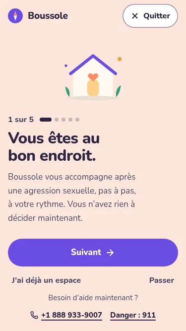 |
| Création de compte | 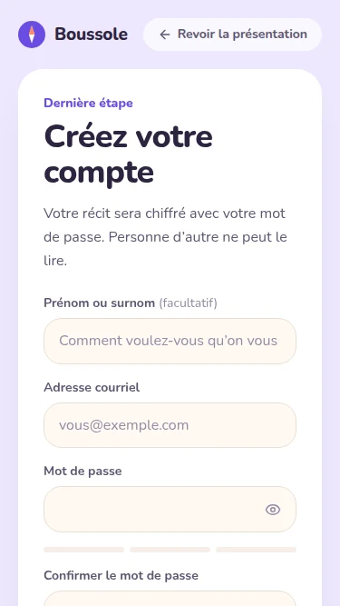 | 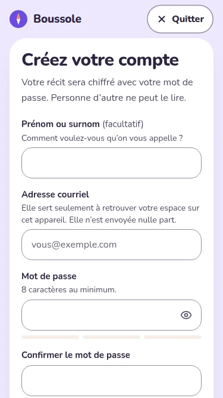 |
| Connexion | 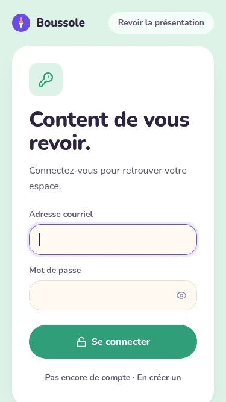 | 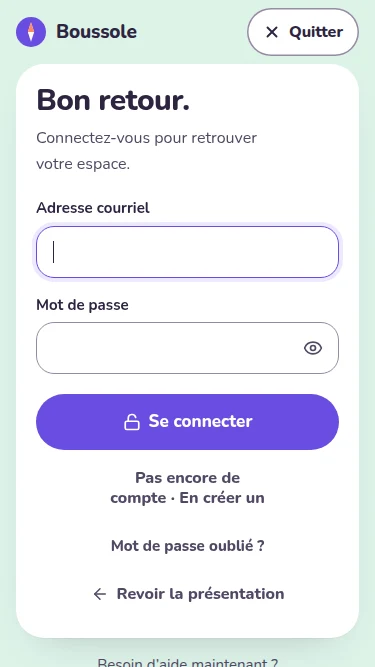 |
| Fenêtre des étapes | 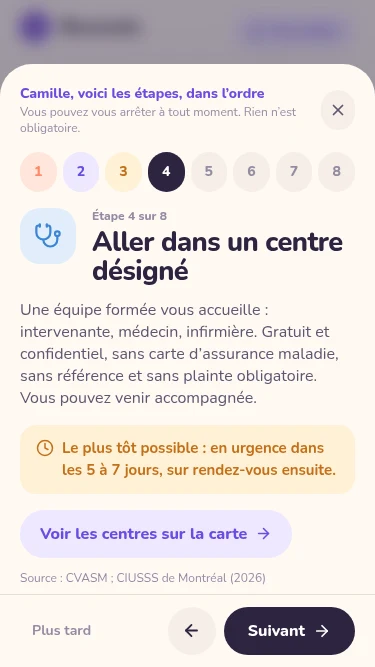 | 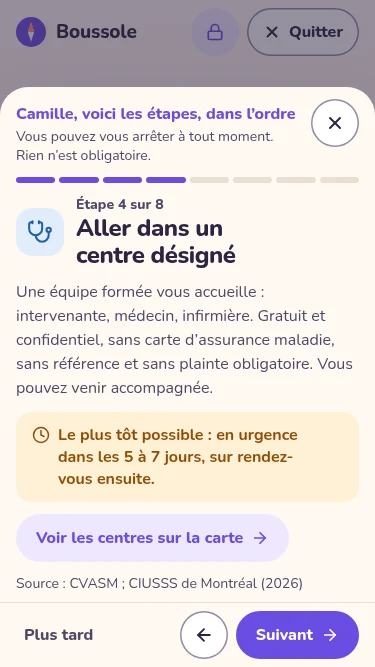 |
| Accueil |  | 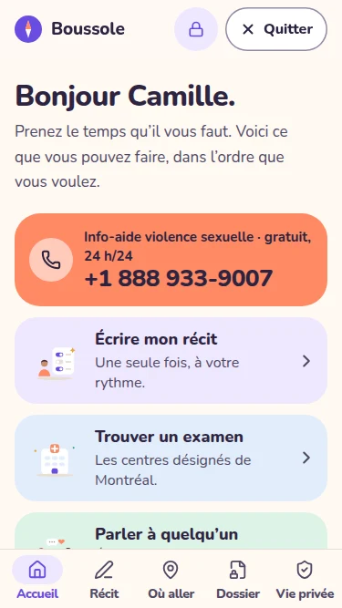 |
| Mon récit | 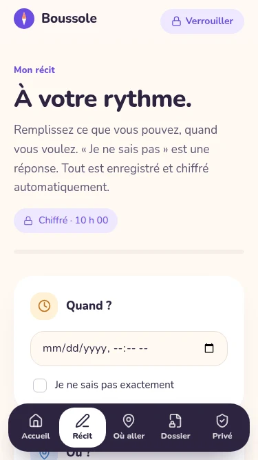 | 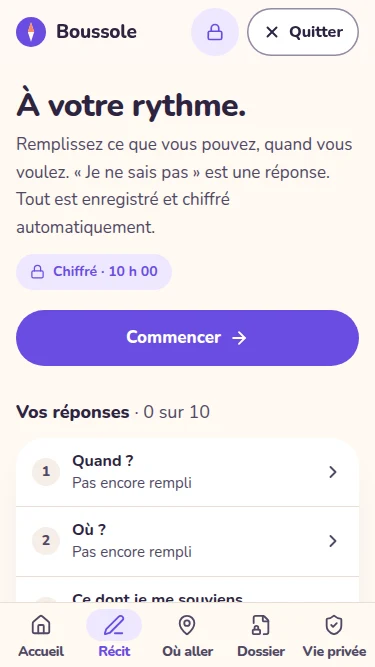 |
| Mon récit, une question | (n'existait pas) | 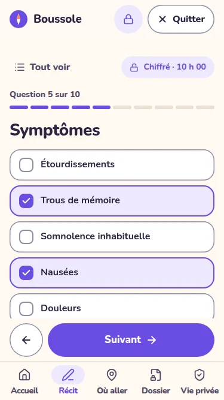 |
| Où aller | 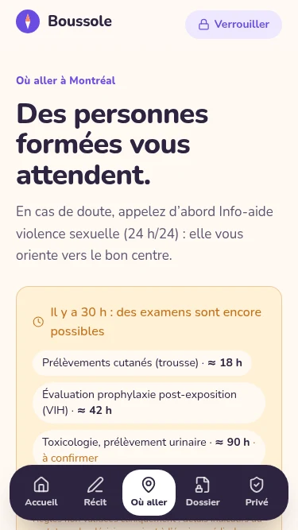 | 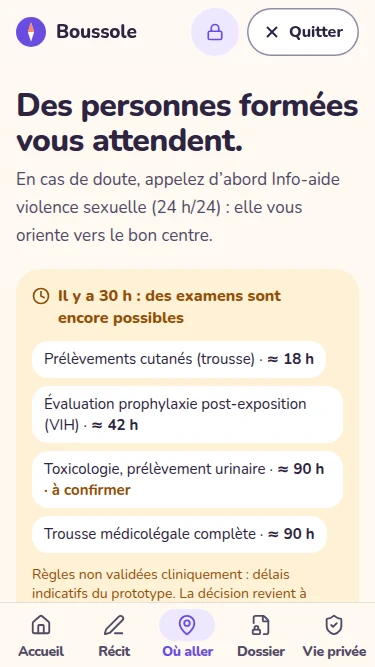 |
| Où aller, la carte | 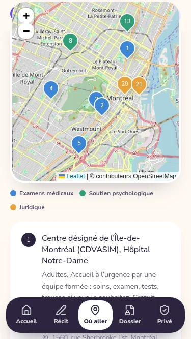 | 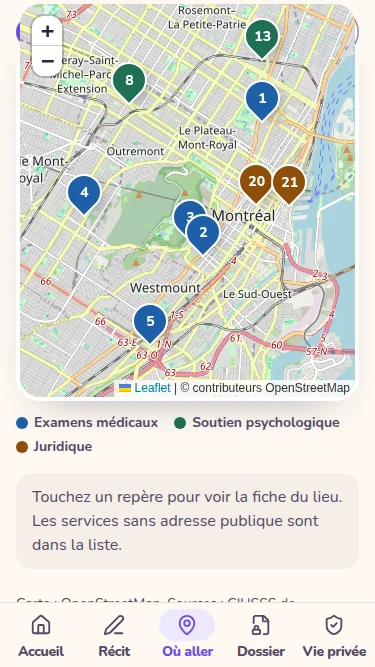 |
| Où aller, une fiche | 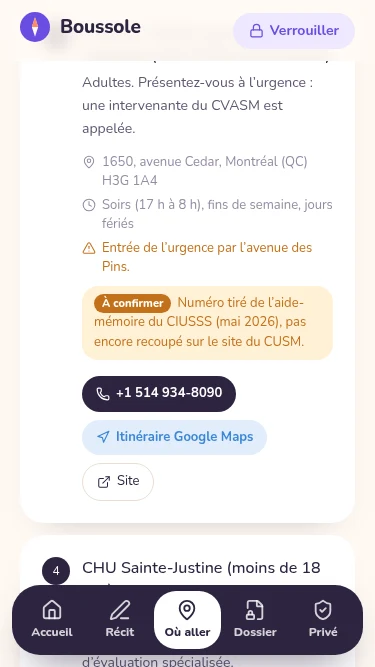 | 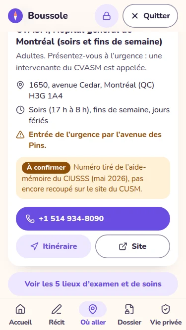 |
| Mon dossier |  | 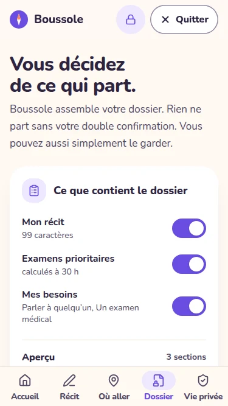 |
| Mon dossier, prêt à envoyer | 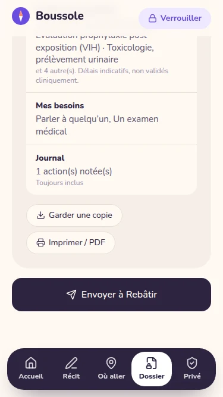 | 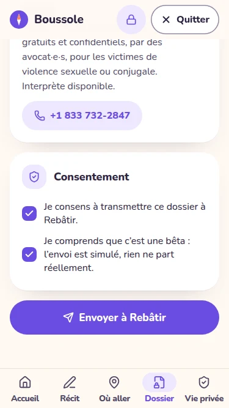 |
| Rappel | 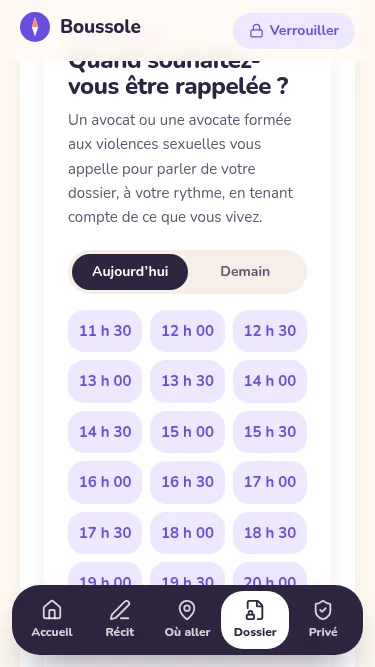 | 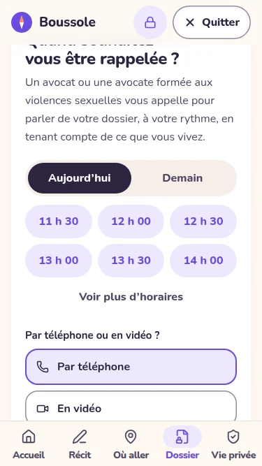 |
| Rappel confirmé | 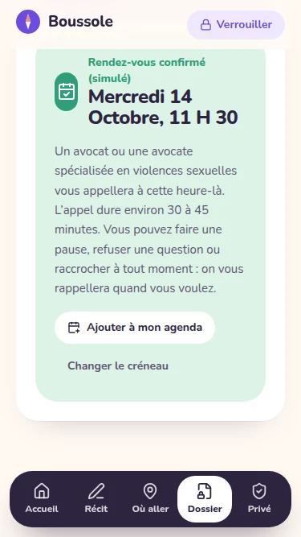 | 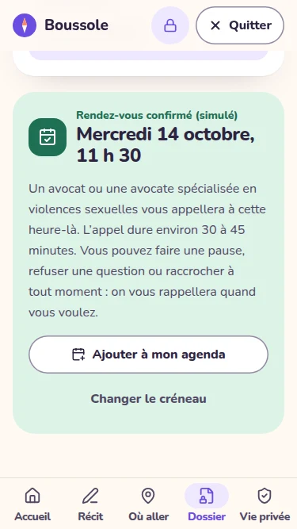 |
| Vie privée | 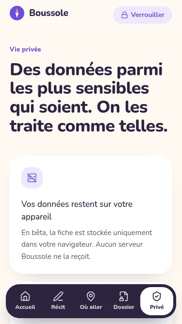 | 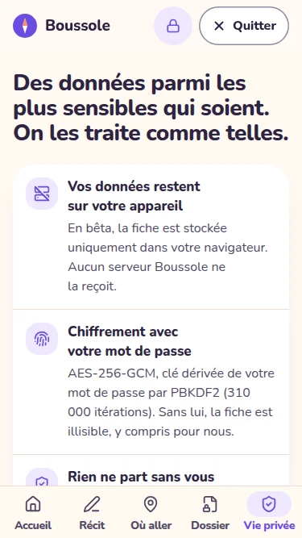 |
| Outil soignant | 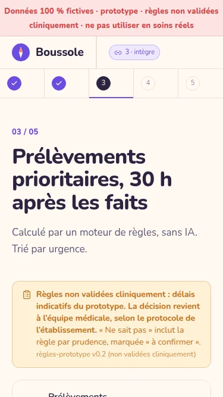 | 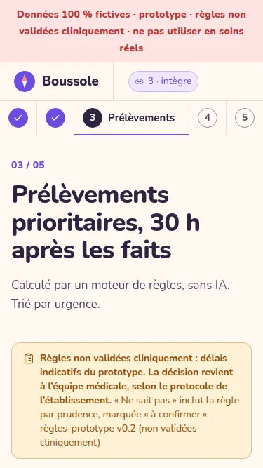 |

## Vérifié après la V2

- `npm run lint` (0 erreur), `npm test` (52 tests, dont 3 nouveaux pour « Quitter »), `npm run build` : réussis à chaque commit.
- Le script de capture rejoue tous les parcours dans les trois formats sans erreur : diapos, compte chiffré, connexion, étapes, récit, liste et carte, dossier, envoi simulé, rappel, verrouillage, outil soignant. Seule erreur de console : le 503 attendu de `/api/timeline` (pas d'IA configurée).
- Hors ligne (service worker du build) : rechargement, connexion, saisie et enregistrement chiffré du récit, ouverture de l'outil soignant.
- Coordonnées : les 32 numéros de téléphone et les adresses présents dans `app/src` sont identiques à ceux de `v1-avant-ux`. `resources.ts`, `rules.ts`, `vault.ts`, `server/`, `pwa/` et `public/` n'ont pas changé. `careSteps.ts` gagne un champ `filter` sur deux boutons, sans toucher aux textes.
- Les mentions « À confirmer », « bêta », « simulé », « non validé cliniquement », « pas d'avis médical » et « Données 100 % fictives » sont toutes présentes, en 14 px au minimum.
- Détecteur d'`impeccable` : aucune alerte.

## Non vérifié

- Vrais téléphones (iOS Safari, Chrome Android) : tout est mesuré en émulation.
- Lecteur d'écran, et taille de police du système agrandie.
- « Quitter » dans la PWA installée : la sortie vers un site externe peut s'ouvrir dans un navigateur intégré.
- Installation de la PWA sur un appareil réel.
